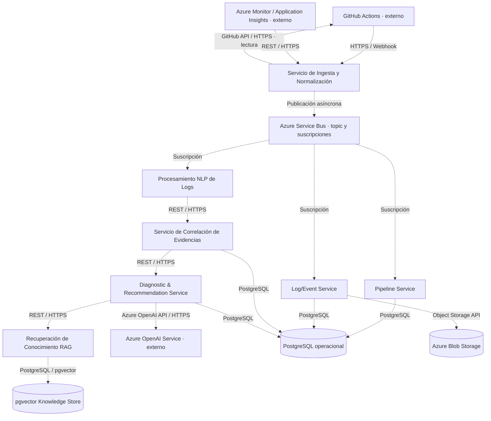

# Overview — Línea base arquitectónica del prototipo AIOps

- **Fecha de inspección:** 19 de octubre de 2026.
- **Repositorio inspeccionado:** `aiops-dac`.
- **Revisión de referencia:** `80f5727b01b461c6e685ff708f9fab2c33eef623` — último commit del 7 de octubre de 2026.
- **Modelo arquitectónico:** `0.4.0-c4-views`, fase `phase_4_c4_views`, estado `draft`. Último cambio del modelo: 3 de octubre de 2026.

Este documento describe la evidencia disponible en este checkout. Es una síntesis de la arquitectura vigente y de su grado de materialización; no modifica decisiones, invariantes, preguntas abiertas ni fuentes de verdad.

## 1. Resumen ejecutivo

El prototipo busca diagnosticar fallos de pipelines CI/CD ya identificados por **GitHub Actions**. El alcance diseñado comprende capturar evidencia autorizada, proteger y normalizar logs y eventos, correlacionar el contexto de ejecución, recuperar conocimiento mediante RAG y solicitar inferencia a un LLM preentrenado. El resultado es una **causa probable**, con evidencia, fuentes, recomendaciones y limitaciones, sujeta a revisión técnica humana. Los canales previstos de consumo son el dashboard web y un artifact publicado por el propio workflow de GitHub Actions. [Arquitectura][arquitectura], [ADR-009], [ADR-010], [ADR-016].

La solución prevista adopta microservicios en repositorios independientes, procesamiento inicial orientado a eventos, DDD donde exista dominio significativo y CQRS lógico. Se han aprobado siete contenedores backend propios, una SPA y servicios gestionados en Azure; compartir una instancia PostgreSQL no autoriza escrituras entre contextos. [ADR-018].

**Lo materializado y validado aquí es el sistema de arquitectura como código (DaC): modelos, validadores, generadores, diagramas y artefactos de persistencia.** No se encontraron implementaciones Java/Spring Boot, Python/FastAPI o React del producto, contratos OpenAPI, imágenes de contenedor de aplicación, IaC ni manifiestos de despliegue. Las 38 clases de diagnóstico están expresamente marcadas `proposed`; no son clases Java ejecutables. [Diseño][diseno], [decisiones de clases][decisiones-clases].

Esto no demuestra que los servicios no existan en otros repositorios: la estrategia multirepo está aprobada, pero este checkout no aporta sus ubicaciones ni evidencia de ejecución. Tampoco permite confirmar recursos cloud desplegados. La línea base distingue, por tanto, **diseño aprobado**, **herramientas implementadas localmente** y **runtime del producto no verificable fuera de este repositorio**.

Los objetivos registrados son reducir el Tiempo Medio de Diagnóstico (**TMD**) al menos un 30 % y alcanzar una precisión mínima del 80 % en identificación de causa probable. Son metas de `validation_contract`, no resultados medidos. La remediación autónoma, un detector propio de anomalías, las integraciones directas con scanners y los canales Teams/Slack/correo quedan fuera del MVP vigente. [Arquitectura][arquitectura], [ADR-010], [ADR-012], [ADR-014].

### Criterio de evidencia y límites

| Tipo de evidencia | Fuente y uso en esta línea base |
|---|---|
| Implementación local | [Makefile](Makefile), `tools/`, [requirements.txt](requirements.txt) y `tests/`: validación y generación documental ejecutables. |
| Arquitectura documentada | [model/architecture.yml][arquitectura]: elementos, relaciones, despliegue previsto, controles e invariantes. `confirmed` significa confirmado en el modelo, no desplegado. |
| Dominio y persistencia diseñados | [model/domain.yml][dominio], [model/domain_decisions.md][decisiones-dominio] y [model/db.dbml][dbml]. El generador actual deriva DBML desde el dominio; no acredita una base instalada. |
| Diseño de implementación | [model/design.yml][diseno] y [model/design_decisions.md][decisiones-clases]: clases propuestas, puertos y adaptadores del servicio diagnóstico. |
| Decisiones y derivación funcional | ADRs `Accepted` y [arquitectura de información][ia]. Las propuestas funcionales históricas se contrastan con el modelo y las decisiones posteriores. |
| Artefactos derivados | `out/` y `build/`: representaciones y salidas de los generadores, no evidencia de operación del producto. |

No están disponibles los originales `tech_drift_resolutions.md`, Project Charter, Trabajo de Investigación ni los Excel de backlog, historias y plan citados por el modelo. Su ausencia también consta en `domain.yml`, assumption `A-011`. No se les atribuyen requisitos adicionales ni se afirma haberlos inspeccionado. La autoridad por materia está documentada en la gobernanza del modelo y [ADR-018]: Charter para alcance, modelo/invariantes/ADRs para arquitectura y drift/ADRs tecnológicos para tecnología.

La inspección combinó `git ls-files`, búsquedas con `rg`, lectura de modelos/ADRs, generadores y pruebas, y las verificaciones locales de la sección 8. Las conclusiones de ausencia se limitan al checkout actual; no abarcan otras ramas, repositorios, registros de imágenes ni cuentas cloud.

En este documento, **documentado/diseñado** identifica declaraciones verificadas en las fuentes; **planificado** identifica trabajo futuro explícito, sin afirmar una programación de entrega; **inferido** conserva el carácter provisional que ya tenga la fuente. La matriz de la sección 8 define los estados de implementación.

## 2. Arquitectura general

El diseño combina dos mecanismos de comunicación:

- **Asíncrono al ingresar evidencia:** ingesta publica en un único topic de Azure Service Bus, con suscripciones para Pipeline Service, Log/Event Service y Procesamiento NLP de Logs.
- **Síncrono en el diagnóstico y el consumo:** NLP → correlación → Diagnostic & Recommendation Service; este consulta RAG y Azure OpenAI mediante API. Dashboard y GitHub Actions acceden al backend por APIM. Dentro del servicio diagnóstico, sus componentes se comunican `in-process`.

Las aplicaciones backend previstas son cinco servicios Java/Spring Boot y dos Python/FastAPI. La SPA usa React/TypeScript. PostgreSQL conserva datos operacionales y pgvector soporta la búsqueda semántica; Blob contiene evidencia extensa referenciada desde el dominio. No hay Event Sourcing, Event Store ni bases separadas para commands y queries. [Arquitectura][arquitectura], [ADR-015], [ADR-018].

### Vista de alto nivel del procesamiento

El siguiente Mermaid representa la membresía de la vista ya declarada **`c4_container_processing`**: sus 14 elementos y las 17 relaciones canónicas directas cuyos extremos pertenecen a ella. Mantiene sistemas externos y no agrupa elementos. **Las flechas punteadas significan relaciones documentadas, no tráfico observado ni integración probada.** Los rótulos identifican el mecanismo de comunicación, no su estado de implementación.

La separación gráfica PostgreSQL/pgvector corresponde a dos elementos lógicos; [ADR-018] prescribe **una sola instancia física PostgreSQL**. La vista no agrega una llamada a embeddings, pues las relaciones del modelo no explicitan ese enlace, aunque su uso esté aprobado en las propiedades de NLP/RAG.

El consumo y la revisión se documentan en la vista [C4 de consumo](out/c4_container_consumption.svg): usuarios → dashboard, autenticación dashboard → Entra ID y acceso dashboard → APIM → Pipeline/Log/Event/Diagnostic. GitHub Actions también consulta diagnóstico por APIM. La descomposición interna se encuentra en [C4 de diagnóstico](out/c4_component_diagnostic.svg). Ambos diagramas son diseño generado, no evidencia de despliegue.

## 3. Componentes y responsabilidades

### Contenedores de aplicación previstos

Todas las filas siguientes tienen estado **Diseñada** en este repositorio. Los IDs corresponden a `elements[]` del [modelo arquitectónico][arquitectura]; los stacks proceden de [ADR-018]. No se encontraron sus proyectos de aplicación ni pruebas funcionales de sus APIs.

| Componente / ID | Responsabilidad | Tecnología prevista | Interfaces y dependencias documentadas |
|---|---|---|---|
| Servicio de Ingesta y Normalización — `ingestion_normalization_service` | Captura autorizada; validación, parsing, limpieza, normalización, minimización, enmascaramiento, anonimización y filtrado de secretos; asignación de `correlationId`. | Java / Spring Boot; Azure Container Apps. | Webhook y lectura GitHub Actions; entrada de observabilidad; publicación en Service Bus. Contexto canónico: pipeline, execution, commit, service, environment y correlationId. |
| Pipeline Service — `pipeline_service` | Registrar workflows monitorizados, ejecuciones y etapas; mantener estado y contexto operacional. | Java / Spring Boot; Azure Container Apps. | Consumidor Service Bus; API vía APIM; propietario de `ops`. |
| Log/Event Service — `log_event_service` | Registrar y consultar evidencia normalizada, conservar metadatos de origen y resolver referencias externas. | Java / Spring Boot; Azure Container Apps. | Consumidor Service Bus; API vía APIM; PostgreSQL para `evidence_items` y Blob para objetos extensos. |
| Procesamiento NLP de Logs — `nlp_log_processor` | Preprocesar logs y preparar representación semántica y señales de evidencia. | Python / FastAPI; Drain3; Azure OpenAI Embeddings; Azure Container Apps. | Consumidor Service Bus; entrega a correlación por REST/HTTPS. No implementa un detector de anomalías. |
| Servicio de Correlación de Evidencias — `evidence_correlation_engine` | Relacionar workflow, run, job, etapa, servicio, commit, tiempos, errores, eventos, métricas disponibles y `correlationId`; preservar procedencia y no mezclar ejecuciones ajenas. | Java / Spring Boot; Azure Container Apps. | Entrada REST desde NLP; PostgreSQL para `correlated_contexts`; entrega REST al servicio diagnóstico. Algoritmo no implementado aquí. |
| Diagnostic & Recommendation Service — `recommendation_service` | Orquestar RAG e inferencia; producir diagnóstico estructurado, recomendaciones y trazabilidad; gestionar revisión humana. | Java / Spring Boot; Azure Container Apps. | Entrada desde correlación y APIM; llamadas a RAG y Azure OpenAI; persistencia en `diagnosis` y auditoría transversal. |
| Recuperación de Conocimiento RAG — `rag_retrieval` | Recuperar conocimiento autorizado, hacer búsqueda semántica, conservar provenance e interactuar con pgvector. | Python / FastAPI; Azure OpenAI Embeddings; Azure Container Apps. | API REST invocada por diagnóstico; propietario de `knowledge`; consulta PostgreSQL/pgvector. No es propietario de la orquestación diagnóstica. |
| Dashboard Web AIOps — `web_dashboard` | Consultar incidentes, diagnósticos, evidencia, recomendaciones, estado y métricas; registrar revisión humana; distinguir hipótesis de diagnóstico validado. | React / TypeScript, SPA; Azure Static Web Apps. | Entra ID para autenticación; REST/HTTPS vía APIM hacia los tres servicios expuestos. Pantallas descritas en [arquitectura de información][ia], sin aplicación frontend en este checkout. |

### Componentes internos del servicio diagnóstico

[ADR-017] define cuatro componentes, todos **Diseñados**, dentro del mismo contenedor; no son cuatro microservicios adicionales.

| Componente / ID | Responsabilidad y realización propuesta |
|---|---|
| Diagnostic API — `diagnostic_api_component` | Recibir contexto/consultas y operaciones de revisión; controllers separados para commands y queries. La URI y el DTO definitivos de recepción están abiertos en `DCQ-002`. |
| Diagnostic Orchestrator — `diagnostic_orchestrator_component` | Coordinar contexto, recuperación e inferencia mediante `KnowledgeRetrievalPort` y `DiagnosticLlmGateway`. |
| Diagnostic Output Composer — `diagnostic_output_component` | Componer causa probable, recomendaciones, evidencias, fuentes, limitaciones y confianza; asociar el resultado al snapshot diagnóstico. |
| Human Review & Diagnostic Governance — `human_review_component` | Validar, corregir o rechazar; registrar revisión, aplicar aprobación humana y clasificación de riesgo. La política concreta de riesgo permanece abierta en `DCQ-001`. |

Las clases, puertos HTTP, adaptadores JPA y la capa de traducción del proveedor se encuentran en [model/design.yml][diseno], con diagramas [CD-1](out/CD-1.svg), [CD-2](out/CD-2.svg) y [CD-3](out/CD-3.svg). Sus nombres y firmas describen diseño propuesto; no acreditan controllers ni clientes implementados.

### Subsistemas efectivamente implementados aquí

| Subsistema DaC | Evidencia funcional local | Alcance comprobado |
|---|---|---|
| Validación de arquitectura, dominio y clases | [tools/validate.py](tools/validate.py), [tools/domain_validation.py](tools/domain_validation.py), [tools/validate_design.py](tools/validate_design.py). | Validación de IDs, relaciones, membresías, ownership, restricciones de dominio y correspondencia del diseño. |
| Generación de vistas | [generador C4](tools/generators/c4.py), [lógica](tools/generators/logical.py), [física](tools/generators/physical.py), generadores de presentación y [adaptador de vistas legacy](tools/run_legacy_views.py). | Producción local de fuentes y diagramas con PlantUML, D2/ELK y Graphviz/Diagrams. |
| Generación persistente | [to_dbml.py](tools/generators/to_dbml.py), [to_sql.py](tools/generators/to_sql.py), [to_er_d2.py](tools/generators/to_er_d2.py), [to_dictionary.py](tools/generators/to_dictionary.py). | DBML, DDL PostgreSQL, constraints adicionales, ER y diccionario. No aplica SQL a una base ni ejecuta migraciones. |
| Generación de clases | [tools/generators/classes.py](tools/generators/classes.py). | Diagramas PlantUML/SVG y navegación C4 → clases; no genera el microservicio. |

Las dependencias Python de estas herramientas están fijadas en [requirements.txt](requirements.txt), incluidas PyYAML `6.0.3` y Diagrams `0.25.1`. Java/PlantUML, Graphviz, D2 y las herramientas DBML son dependencias locales de generación; su presencia no acredita el stack de aplicación.

## 4. Flujo de procesamiento y diagnóstico

**No se verificó un recorrido operativo de extremo a extremo del producto.** La reconstrucción siguiente corresponde a relaciones y contratos documentados; cada paso tiene estado **Diseñada**. El único flujo ejecutado en esta inspección fue modelo → validación → artefactos.

| Paso | Flujo diseñado | Evidencia y límite de implementación |
|---|---|---|
| 1. Identificación del fallo y adquisición | GitHub Actions proporciona el estado fallido. Emite eventos autorizados a ingesta, que recupera logs, artifacts y metadatos mediante la API. Observabilidad puede aportar evidencia autorizada adicional. | `rel_github_actions_ingestion_event`, `rel_ingestion_github_actions_read`, `rel_observability_sources_ingestion` en [arquitectura]. Sin webhook handler ni cliente operativo aquí. |
| 2. Protección y normalización | Ingesta valida, limpia, filtra ruido y secretos, anonimiza, minimiza y añade contexto canónico y `correlationId` antes de publicar. | Capacidades de `ingestion_normalization_service`, `INV-001` y `INV-002`. No existen transformaciones de aplicación ni muestras que demuestren saneamiento efectivo. |
| 3. Distribución asíncrona | Un topic alimenta tres suscripciones: Pipeline registra contexto, Log/Event conserva evidencia y NLP procesa logs. | `azure_service_bus.topology` y relaciones `rel_service_bus_*`. No hay recursos aprovisionados ni consumidores ejecutables en el checkout. No se define una barrera que sincronice las tres ramas. |
| 4. Parsing y representación | NLP usa Drain3; embeddings se destinan a recuperación semántica. Entrega evidencia procesada a correlación. | [ADR-007], [ADR-010], `rel_nlp_correlation`. No se encontró configuración de Drain3 ni llamadas de embeddings implementadas. |
| 5. Correlación operacional | Se reúne contexto de la ejecución sin fusionar ejecuciones no relacionadas; se conservan IDs de evidencia y provenance, y se entrega contexto a diagnóstico. | `evidence_correlation_engine`, `rel_correlation_recommendation`; `evidence.correlated_contexts` y `DD-014`. No hay algoritmo ni prueba funcional del correlador. |
| 6. Recuperación contextual | El orquestador solicita conocimiento a RAG; RAG busca en pgvector sobre incidentes revisados, documentación y procedimientos autorizados. | [ADR-015], `rel_recommendation_rag`, `rel_rag_pgvector`. La carga y actualización del corpus siguen abiertas (`DQ-004`). |
| 7. Inferencia diagnóstica | Diagnóstico envía evidencia saneada y priorizada, contexto correlacionado y conocimiento RAG a Azure OpenAI. La respuesta retorna por la misma llamada síncrona. | `pretrained_llm_diagnostic_service.input_contract`, `rel_recommendation_llm`. No hay prompts ejecutables, cliente de inferencia ni resultados evaluados. |
| 8. Composición y persistencia | Se produce `diagnostic_output`: `incident_id`, `execution_context`, `failure_summary`, `probable_cause`, `supporting_evidence`, `consulted_sources`, `recommendations`, `limitations`, `confidence`. Se conserva cada versión diagnóstica y sus vínculos. | `recommendation_service.diagnostic_output`, [diseño][diseno], `DD-003`, `DD-007`. La generación de DDL no prueba persistencia transaccional real. |
| 9. Consumo y revisión | Dashboard consulta por APIM. Human Review registra validación, corrección o rechazo y auditoría. El resultado automático continúa siendo causa probable hasta validación técnica. | [ADR-011], [ADR-016], `INV-005/006`. No hay UI, políticas API ni endpoints ejecutables aquí. |
| 10. Artifact CI/CD | GitHub Actions consulta el resultado por APIM → diagnóstico y lo publica con un paso nativo del workflow. | `outputs.github_actions_diagnostic_artifact`, `rel_github_actions_apim_diagnostic`, [ADR-016]. No se encontró el workflow; el formato está declarado como detalle de implementación. |

**Detección de anomalías:** no forma parte de esta cadena. [ADR-010] retiró el detector y dejó LogBERT fuera del MVP. El análisis busca explicar un fallo conocido; no prueba automáticamente una causa raíz ni ejecuta remediaciones.

## 5. Integraciones e infraestructura

### Integraciones y recursos declarados

Las declaraciones siguientes son decisiones arquitectónicas, **no IaC ni inventario de recursos desplegados**.

| Integración / recurso | Mecanismo y uso previsto | Evidencia / situación verificable |
|---|---|---|
| GitHub y GitHub Actions | GitHub App con permisos de lectura y installation tokens; webhook y consultas HTTPS para evidencia. Publicación de artifact por el workflow. | [ADR-005], [ADR-016]. Sin manifiesto de App, configuración de permisos, receptor ni workflow verificable en este repo. |
| Azure Monitor / Application Insights | Fuente compatible de telemetría y observabilidad técnica del prototipo. | [ADR-002], `observability_sources`, `audit_trail.technical_observability`. Sin instrumentación de servicios ni configuración cloud. |
| Microsoft Entra ID | Autenticación y emisión de tokens; dashboard usa OIDC/OAuth2/HTTPS. | [ADR-003], [ADR-016]. Sin registro de aplicaciones, configuración de tenant ni políticas ejecutables. |
| Azure API Management | Perímetro y enrutamiento REST/HTTPS hacia Pipeline, Log/Event y diagnóstico. También recibe la consulta de GitHub Actions. | [ADR-006], [ADR-016]. Sin definición de APIs ni políticas APIM; el mecanismo específico de autenticación Actions → APIM no está especificado. |
| Azure Service Bus | Un topic, tres suscripciones para los consumidores declarados. | `azure_service_bus.topology`. Sin nombres de recursos, configuración de entrega, reintentos o manejo de mensajes fallidos verificables. |
| Azure OpenAI Service | Servicio externo gestionado, API HTTPS; familia GPT-4 e inferencia sin hosting propio. Embeddings aprobados para recuperación. | [ADR-004], [ADR-007], [ADR-015]. No hay despliegue de modelo, endpoint, variante GPT-4 ni modelo concreto de embeddings fijados. |
| PostgreSQL + pgvector | Una instancia física; cinco schemas; conocimiento vectorial y datos operacionales separados por ownership. | [ADR-018], [dominio], [dbml]. Existen generadores y DDL derivado; no evidencia de ejecución SQL ni extensión instalada. No se fija un servicio de hosting PostgreSQL concreto. |
| Azure Blob Storage | Objetos extensos de logs/evidencia/artifacts; referencias mediante metadatos. | `object_evidence_store`, `DD-006`. Sin cuentas, contenedores o políticas de ciclo de vida desplegadas verificables. |
| Azure Container Apps | Hosting previsto de los siete contenedores backend propios. Azure OpenAI, Entra ID y APIM tienen fronteras gestionadas distintas. | [ADR-001] actualizado por [ADR-009], [ADR-010], [ADR-011], [ADR-015]. Sin Dockerfiles, imágenes, registros ni manifiestos de despliegue en este checkout. |
| Azure Static Web Apps | Hosting de la SPA React/TypeScript. | [ADR-008], [ADR-018]. Sin proyecto frontend ni configuración de hosting. |

### Persistencia y contratos

El [modelo de dominio][dominio] contiene **17 tablas modeladas**: 16 `confirmed` y una `inferred`, no 17 tablas verificadas en una base. `ops` pertenece a Pipeline; `evidence_items` a Log/Event y `correlated_contexts` a correlación dentro de `evidence`; `diagnosis` al servicio diagnóstico; `knowledge` a RAG; `audit` a la capacidad transversal compartida. Cada servicio escribe solo sus tablas. Se permiten FK físicas intra-schema y referencias lógicas entre schemas; no navegación JPA entre contextos. [ADR-018], `DD-008/012/014`.

El dominio fija Repository separado de Pipeline, donde Pipeline equivale a workflow monitorizado; cada incidente tiene un ORIGIN fallido y puede tener ejecuciones VERIFICATION. Diagnósticos son snapshots versionados append-only; recomendaciones son entidades propias; evidencia extensa se conserva por referencia a Blob. El generador produce SQL para constraints ORIGIN y append-only, pero las pruebas disponibles inspeccionan su generación, no su comportamiento en PostgreSQL. [Decisiones del dominio][decisiones-dominio], [pruebas de generación][test-dominio].

Los contratos disponibles son conceptuales: campos canónicos en YAML, protocolos en `relationships[]`, firmas abreviadas en el diseño y ejemplos REST en [arquitectura de información][ia]. Rutas como `/api/incidents` y `/api/pipelines` no acreditan endpoints implementados ni un contrato OpenAPI versionado. La recepción de contexto correlacionado carece de URI/DTO final (`DCQ-002`).

### Entornos y despliegue

`deployment.validation_environment` prescribe un entorno controlado con evidencia anonimizada, sintética o expresamente autorizada; producción no es obligatoria. No hay configuración por entorno, variables de runtime, definición de redes o aislamiento, IaC ni resultados de despliegue que permitan verificar dev/preproducción/producción. Los YAML de `model/` configuran arquitectura y presentación, no entornos de aplicación. La existencia y estado real de recursos Azure quedan **No verificables** sin evidencia adicional de los repositorios y entornos correspondientes.

## 6. Componentes de inteligencia artificial

| Capacidad | Decisión vigente / tratamiento diseñado | Implementación y decisiones aún abiertas |
|---|---|---|
| Tratamiento de logs y eventos | Protección en ingesta antes de NLP/RAG/LLM; Drain3 para parsing; correlación por contexto de ejecución y procedencia. | Diseñada. No existen pipeline de datos, configuración del parser ni pruebas con logs de aplicación en este repo. |
| Representación semántica | Azure OpenAI Embeddings, destinada a recuperación/RAG. | Proveedor aprobado; modelo y dimensión sin fijar. `knowledge_chunks.embedding` usa `vector` sin dimensión fija y admite `null` durante carga. No hay índice vectorial dependiente de dimensión seleccionado (`DD-009`, `DQ-003`). |
| Recuperación de evidencia histórica | Corpus limitado a incidentes revisados, documentación técnica autorizada y procedimientos de respuesta autorizados. `knowledge_documents` y `knowledge_chunks` conservan provenance. | Diseñada. Elegibilidad y saneamiento requieren aplicación; la estructura SQL no valida semánticamente el texto. Carga/actualización pendiente (`DQ-004`). |
| RAG | Servicio especializado de recuperación y búsqueda semántica en pgvector; diagnóstico solicita y usa su contexto. `diagnosis_source_links` conserva referencias lógicas a chunks consultados. | Diseñada. No se encontraron corpus, consultas de recuperación, segmentación ejecutable ni una estrategia de ranking evaluada. |
| Inferencia diagnóstica | Azure OpenAI Service, familia GPT-4, integrado por API; no se aloja el modelo en Container Apps. | Diseñada; `model: null`. No se selecciona variante, versión ni configuración de inferencia en esta línea base. |
| Orquestación | Pertenece a `recommendation_service`, no al servicio RAG. Puertos `KnowledgeRetrievalPort` y `DiagnosticLlmGateway`, adaptadores HTTP y `LlmResponseTranslator` aíslan el proveedor en el diseño de clases. | Las clases están `proposed`. No existe un orquestador ejecutable ni una estrategia implementada de fallos parciales. [ADR-015], [decisiones de clases][decisiones-clases]. |
| Verificación del diagnóstico | Evidencia sustentante, fuentes consultadas, limitaciones, confianza cuando aplique y revisión humana. | No se verificó validación automática de afirmaciones ni calibración de confianza. `DQ-002` mantiene abierta su escala/semántica; `confidence` JSONB nullable no resuelve esa decisión. |

La revisión humana diferencia `CONFIRMED`, `CORRECTED` y `REJECTED`; `CORRECTED` requiere una causa corregida no vacía. `PENDING` se deriva de ausencia de revisión, no es una decisión persistida. La corrección no reescribe el snapshot original. Son reglas diseñadas en `DD-003/005` y en el [modelo de clases][diseno], no un flujo de revisión validado en una aplicación.

El modelo prohíbe entrenar desde cero o modificar pesos; los casos de evaluación y sus soluciones de referencia deben permanecer fuera del corpus RAG (`INV-008/010`, `CTRL-006`). No se encontraron conjuntos de evaluación del diagnóstico ni mediciones de precisión/TMD. Las pruebas de DaC no evalúan calidad de recuperación o de inferencia. LogBERT sigue siendo una posible extensión futura, no una tecnología activa ni una decisión pendiente que bloquee el MVP. [ADR-010].

## 7. Seguridad, privacidad y gobernanza

Los controles del producto están **documentados y diseñados**. Los validadores locales comprueban restricciones del modelo, sin demostrar que los controles se cumplan en runtime.

| Control | Regla vigente | Evidencia y límite |
|---|---|---|
| Acceso CI/CD | Read-only por defecto y mínimo privilegio mediante GitHub App/installation tokens. El prototipo no sube artifacts ni modifica repositorios. | `INV-003`, [ADR-005], [ADR-016]. La carga del artifact corresponde al workflow con su propio mecanismo; no amplía permisos de la App. No se verificaron permisos efectivos. |
| Identidad y autorización | Entra ID, APIM y acceso por roles al dashboard. | [ADR-003], [ADR-016]. RBAC granular por pipeline continúa abierto (`DQ-005`); `pipeline_access_grants` conserva `scope_basis: ia_only` y `status: inferred`, no es una implementación RBAC final. |
| Credenciales | Installation tokens en la integración GitHub. | [ADR-005] exige no decidir aún almacenamiento de secretos ni Key Vault. No hay evidencia suficiente para describir almacenamiento, rotación o permisos de credenciales. |
| Privacidad y confidencialidad | Enmascaramiento, anonimización, minimización y filtrado de secretos antes de NLP/RAG/LLM; el LLM no recibe logs crudos. No guardar SAS, secretos ni payload sensible crudo en referencias de evidencia o auditoría. | `CTRL-002`, `INV-001/002`, `DD-006/016`, `A-010`. Texto/JSON y un tipo llamado `SanitizedDiagnosticContext` no prueban saneamiento efectivo; faltan controles ejecutables. |
| Entornos y aislamiento | Validación controlada con evidencia permitida; ownership de datos por tabla/contexto. | `deployment.validation_environment`, [ADR-018]. No se verificaron redes, aislamiento de entornos ni permisos PostgreSQL que hagan cumplir el ownership. |
| Auditoría y trazabilidad | `correlationId` end-to-end; generación diagnóstica, uso de evidencia, revisión y eventos de acceso/gobierno en PostgreSQL. Azure Monitor/Application Insights complementan la observabilidad técnica. | `CTRL-003/004`, `audit_trail`, [ADR-011], `DD-016`. No existe `audit_service`; falta verificar instrumentación funcional de los servicios. |
| Gobierno humano | Revisiones con `diagnostic_id`, `reviewer`, `decision`, `timestamp`, `correlationId`; posibilidad de validar, corregir y rechazar. Sin remediación autónoma. | `CTRL-005`, `INV-005/006/007`, [ADR-016]. Clasificación concreta de riesgo no definida (`DCQ-001`). |
| Retención | 365 días para logs, diagnósticos y evidencias, basados en política corporativa comunicada por el stakeholder. | [ADR-013], `INV-009`, `DD-015`. Hay timestamps diseñados, sin tareas de purga ni políticas Blob verificables. No se extiende automáticamente el plazo a configuración, corpus o auditoría. |
| Separación evaluación/RAG | Excluir casos y soluciones de evaluación del conocimiento recuperable. | `CTRL-006`, `INV-010`, `DD-007`, [pruebas de dominio][test-dominio]. Las comprobaciones estructurales no verifican contenido real de un corpus. |

## 8. Estado de implementación

La clasificación se aplica al objeto descrito y a la evidencia de este checkout:

- **Implementada:** existe implementación funcional comprobada localmente para el alcance indicado.
- **Parcial:** existe desarrollo de la capacidad, pero faltan partes o integraciones. Un diagrama o una clase propuesta no bastan para asignar este estado al runtime.
- **Diseñada:** la capacidad está documentada, sin implementación funcional encontrada aquí.
- **Pendiente de decisión:** las fuentes conservan expresamente una definición abierta; no se resuelve en este documento.
- **No verificable:** la evidencia no permite determinar su estado, especialmente fuera del repositorio.

| Capacidad / objeto evaluado | Estado | Evidencia concreta y alcance |
|---|---|---|
| Validación del modelo arquitectónico | **Implementada** | `make validate`, [tools/validate.py](tools/validate.py), [test_architecture_validation.py][test-arquitectura]. Validación local del modelo, no health check del producto. |
| Generación física, lógica, C4 y presentaciones | **Implementada** | `make all`, generadores en `tools/generators/`; [pruebas C4][test-c4], [lógicas][test-logica], [físicas][test-fisica] y [C4 de presentación][test-c4-expo]. |
| Generación DBML/SQL/ER/diccionario | **Implementada** | `make db`, [to_sql.py](tools/generators/to_sql.py), [test_domain_generation.py][test-dominio]. No comprende instalación ni ejecución transaccional de PostgreSQL. |
| Validación y diagramas del diseño de clases | **Implementada** | `make classes`, [test_design_generation.py][test-diseno]. Su prueba `test_implemented_requires_real_microservice_not_renderer_code` impide confundir renderizadores con clases de producto. |
| Ingesta, normalización y protección operativa | **Diseñada** | `elements.ingestion_normalization_service`, `INV-001/002`, [ADR-018]. Sin servicio Java ni pruebas funcionales. |
| Registro de pipelines/incidentes y gestión de evidencia | **Diseñada** | `pipeline_service`, `log_event_service`; schemas `ops`/`evidence` en [dominio]. Sin APIs, consumidores ni repositorios de aplicación aquí. |
| Mensajería y consumidores | **Diseñada** | `azure_service_bus.topology`, relaciones `rel_service_bus_*`. Sin configuración de recursos ni consumidores ejecutables. |
| Parsing NLP y correlación | **Diseñada** | `nlp_log_processor`, `evidence_correlation_engine`, [ADR-007], [ADR-010]. Sin parsing/correlación ejecutables del producto. |
| Recuperación RAG y orquestación/inferencia | **Diseñada** | `rag_retrieval`, `recommendation_service`, [ADR-015], clases de [diseño][diseno]. Sin llamadas o evaluaciones de integración. |
| Persistencia operacional y vectorial del producto | **Diseñada** | 17 tablas modeladas, cinco schemas; [ADR-018], [dbml], `DD-002/003/009`. DDL generado sin aplicación a una base verificada. |
| Dashboard, APIs y publicación del artifact | **Diseñada** | `web_dashboard`, `outputs`, [ADR-008], [ADR-016], propuestas REST en [IA][ia]. Sin SPA, endpoints ni workflow implementados en el checkout. |
| Revisión humana, auditoría, retención y controles de runtime | **Diseñada** | `human_review_component`, `cross_cutting_controls`, `retention`; [ADR-011], [ADR-013]. Las restricciones de modelo no son pruebas de operación. |
| Medición diagnóstica de TMD/precisión | **Diseñada** | `validation_contract`, `DD-015`. No hay benchmark, dataset evaluado ni resultados que acrediten los objetivos. |
| Severidad, confianza y dimensionamiento de embeddings | **Pendiente de decisión** | `DQ-001/002/003` de [dominio]. GPT-4 concreto también permanece sin fijar en el modelo arquitectónico, aunque no tenga un OQ activo. |
| Actualización del corpus, RBAC por pipeline y alta de workflows | **Pendiente de decisión** | `DQ-004/005/006`; `pipeline_access_grants` sigue inferido. |
| Política de riesgo, contrato REST de recepción y rehidratación de consulta | **Pendiente de decisión** | `DCQ-001/002/003` de [diseño]. |
| Implementaciones alojadas en otros repositorios | **No verificable** | Multirepo en [ADR-018]; no hay inventario de repositorios de los servicios ni evidencia de su ejecución en este checkout. |
| Despliegues reales y configuración de recursos cloud | **No verificable** | Declaraciones `deployment` sin IaC, estado de despliegue ni observación de entornos. |
| Contenido original de Charter/TI/drift y Excel citados | **No verificable** | Archivos ausentes; `A-011` de [dominio]. Se conoce su referencia, no su contenido original. |

No se clasificó ningún microservicio como **Parcial**: la evidencia encontrada es de diseño, no de desarrollo funcional incompleto. Las capacidades retiradas del MVP no se contabilizan como implementación faltante.

### Verificaciones ejecutadas para esta línea base

| Verificación | Resultado observado |
|---|---|
| `make validate` sobre el checkout | Arquitectura y dominio: **PASSED**. |
| `make all` sobre copia temporal de los archivos versionados | **Exit 0**. Incluye generación y validaciones de presentaciones, dominio y clases. Todos los smoke checks del entorno mostraron `OK`. |
| `.venv/bin/python -m unittest discover -s tests -v` sobre esa copia | **84 pruebas, OK**. Cubren el compilador DaC, los modelos y la presentación; incluyen renderizado local, no ejecución de servicios AIOps. |
| Comparación de archivos versionados con las salidas regeneradas | **Sin diferencias de contenido** después de generación y pruebas. |

La copia temporal utilizó las dependencias ya instaladas del entorno local. No se instalaron paquetes, aplicaron recursos, consultaron servicios externos ni ejecutaron SQL contra una base. Solo se añade este `Overview.md` al checkout. `make all` no ejecuta la suite unittest; ambas verificaciones se realizaron por separado. El resultado demuestra reproducción local con este entorno, no reconstrucción independiente desde un entorno vacío.

La generación C4 conserva ocho advertencias: una descripción vacía para `aiops`; combinación de estilos `event+sync` en la relación agregada GitHub Actions → sistema; y tecnología sin especificar para `diagnostic_api_component`, `diagnostic_orchestrator_component`, `diagnostic_output_component`, `human_review_component`, `github` y `github_actions`. No hubo iconos de fallback (`fallback_icons: []`). No se realizó una revisión visual manual exhaustiva; las pruebas de presentación C4 verificaron su lienzo y ausencia de avisos de desbordamiento.

## 9. Brechas y riesgos arquitectónicos

### Problemas y diferencias comprobados

| Hallazgo | Evidencia / implicación |
|---|---|
| La arquitectura del producto está más materializada documentalmente que en código verificable en este repo. | `tools/` implementa DaC; no se encontraron servicios de aplicación, frontend ni IaC. Por la decisión multirepo, esto es una brecha de evidencia local, no prueba de inexistencia en el proyecto completo. |
| Faltan fuentes originales citadas. | `A-011` y ausencia de Charter/TI/drift/Excel. `CF-001` figura resuelto y conserva una acción para corregir la cabecera del drift; no se puede verificar su ejecución sin el archivo. |
| ADRs históricos todavía describen elementos retirados. | [ADR-001] menciona detector, audit y reporting; [ADR-006] incluye audit/reporting; [ADR-007] conserva OQ-001 y LogBERT candidato. [ADR-009], [ADR-010], [ADR-011] y [ADR-016] establecen el estado posterior. No son servicios activos omitidos del MVP ni decisiones reabiertas; deben leerse con sus sustituciones. |
| La arquitectura de información conserva formulaciones anteriores al dominio actual. | Enum `ValidationStatus` sin `CORRECTED` y decisiones de BD todavía expuestas como abiertas en [IA][ia]. `DD-001/002/003/005/006/007` ya fijan identidad de Pipeline, ORIGIN/VERIFICATION, snapshots, revisión y referencias. La implementación futura debe contrastar ambos niveles, sin copiar automáticamente ejemplos históricos. |
| Las preguntas abiertas están distribuidas. | `architecture.yml.open_questions: []` y `conflicts.unresolved: []` no eliminan las seis DQ del dominio y las tres DCQ nuevas del diseño. `DQ-002` también se referencia en diseño; no es una décima pregunta distinta. |
| Los contratos de integración son incompletos para ejecutar interoperabilidad. | Protocolos y campos conceptuales sin OpenAPI/DTO definitivo; `DCQ-002/003` abiertos. Topología Service Bus declarada sin contratos ejecutables de consumidores. |
| Hay una diferencia entre la regla general de vistas y la proyección C4 existente. | [AGENTS.md](AGENTS.md) prohíbe colapsar implícitamente sin `collapse`; la vista base de procesamiento no lo declara. Sin embargo, `project()` en [c4.py](tools/generators/c4.py) agrupa PostgreSQL/pgvector automáticamente: 14 miembros se representan con 13 nodos; [test_processing_projects_one_physical_postgres][test-c4] verifica ese comportamiento. Es una diferencia de presentación/gobernanza, no evidencia de una segunda base física. Se registra sin cambiar modelo ni generador. |
| La autoridad de DBML requiere una lectura explícita del flujo vigente. | [AGENTS.md](AGENTS.md) identifica `model/db.dbml` como SSOT de BD; [ADR-018], [decisiones del dominio][decisiones-dominio] y `make db` lo derivan desde `domain.yml`. La inspección describe ambos hechos, sin redefinir gobernanza ni editar DBML. |
| Persisten advertencias de documentación/presentación. | Las ocho advertencias C4 de la sección 8 no impidieron validar ni regenerar. No se resolvieron inventando descripciones o tecnologías; la inspección no certifica todos los aspectos visuales. |

### Riesgos potenciales, todavía sin fallo operativo demostrado

| Riesgo | Base verificable y validación que falta |
|---|---|
| Referencias lógicas inconsistentes entre contextos | [ADR-018] y `DD-008/014` delegan validación a los owners. No se selecciona un mecanismo adicional de consistencia distribuida. Faltan pruebas de referencias ausentes y coordinación de las ramas asíncronas. |
| Fallos o latencias acumuladas del diagnóstico síncrono | Cadena NLP → correlación → diagnóstico → RAG/LLM en [ADR-015]. No hay política ejecutable de timeouts, reintentos, duplicados o recuperación de errores que permita evaluar disponibilidad y repetición segura. |
| Recuperación o diagnósticos de calidad insuficiente | Modelo/dimensión de embeddings, actualización de corpus y semántica de confianza pendientes; sin corpus o benchmark. No se pueden acreditar las metas de precisión/TMD ni la utilidad de evidencia recuperada. |
| Datos sensibles o contaminación evaluación/RAG | `A-010` reconoce que constraints estructurales no garantizan elegibilidad ni saneamiento del texto. Faltan controles y pruebas sobre contenido real antes de habilitar inferencia o corpus operativos. |
| Retención no materializada y mantenimiento de snapshots inmutables | `DD-003/015` y el SQL adicional bloquean UPDATE/DELETE/TRUNCATE de diagnósticos, sin procedimiento controlado de mantenimiento. Se requiere validar su compatibilidad operacional con la política de 365 días; no se demuestra incumplimiento de una base desplegada. |
| Integración bloqueada por configuración no definida | Permisos efectivos, gestión de secretos, autenticación Actions → APIM, aislamiento y despliegues no verificables. Son dependencias de implementación que no deben completarse con tecnologías supuestas. |
| Reproducción en otra estación no asegurada por esta ejecución | Python está fijado en `requirements.txt` a nivel de paquetes; [decisiones del dominio][decisiones-dominio] registra versiones de herramientas externas y exige conservarlas. La prueba local no valida aprovisionamiento ni versiones equivalentes en un entorno nuevo. |

## 10. Decisiones vigentes y evolución prevista

### Decisiones consolidadas

Los 18 ADRs disponibles están marcados `Accepted` y fechados el 3 de octubre de 2026. Las decisiones posteriores sustituyen partes de las anteriores sin borrar su historial.

| Tema | Decisión vigente / referencia |
|---|---|
| Aplicación y datos | Microservicios multirepo; Java/Spring Boot, Python/FastAPI y React/TypeScript; DDD táctico; CQRS lógico; una instancia PostgreSQL y ownership por tablas/schemas. [ADR-018]. |
| Hosting y perímetro | Container Apps para backend propio; Static Web Apps para SPA; Entra ID y APIM gestionados. [ADR-001], [ADR-003], [ADR-008], [ADR-015], [ADR-016]. |
| Observabilidad | Azure Monitor + Application Insights; observabilidad técnica separada del audit trail funcional. [ADR-002], [ADR-011]. |
| Entrada CI/CD | GitHub Actions como frontera inicial; GitHub App read-only e installation tokens. Scanners solo aportan evidencia indirecta por logs/eventos/artifacts. [ADR-005], [ADR-014]. |
| IA y orquestación | Drain3; Azure OpenAI Embeddings para RAG; inferencia Azure OpenAI/GPT-4 por API; orquestación en diagnóstico, recuperación en RAG. [ADR-004], [ADR-007] con detector retirado por [ADR-010], [ADR-015], [ADR-017]. |
| Consumo y gobierno | Dashboard vía APIM; output estructurado; artifact publicado por workflow; revisión humana interna y auditoría transversal, sin reporting ni audit service independientes. [ADR-006], [ADR-009], [ADR-011], [ADR-016]. |
| Alcance y conservación | Sin detector propio, canales de notificación ni remediación autónoma en MVP; 365 días para logs/diagnósticos/evidencias. [ADR-010], [ADR-012], [ADR-013], `INV-007`. |

### Decisiones expresamente abiertas

| ID / fuente | Definición pendiente, conservada sin resolución |
|---|---|
| `DQ-001` — [dominio] | Regla concreta de derivación de severidad; no derivarla automáticamente de criticality o nivel de log. |
| `DQ-002` — [dominio] y [diseño][diseno] | Semántica y escala de `confidence`. Su representación JSONB/Object conserva el vacío de definición. |
| `DQ-003` — [dominio] | Dimensión del embedding; el modelo concreto permanece sin fijar. |
| `DQ-004` — [dominio] | Mecanismo definitivo de carga y actualización del corpus RAG. |
| `DQ-005` — [dominio] | Implementación final de RBAC granular por pipeline. |
| `DQ-006` — [dominio] | Política funcional final para alta de workflows monitorizados. |
| `DCQ-001` — [diseño][diseno] | Política de clasificación de riesgo: sin algoritmo, categorías ni umbrales aprobados. |
| `DCQ-002` — [diseño][diseno] | URI y DTO final de recepción REST de contexto correlacionado. |
| `DCQ-003` — [diseño][diseno] | Fuente concreta para rehidratar `executionContext` y `failureSummary` al consultar `DiagnosticView`; no se elige almacenamiento, joins ni comunicación nueva. |

Otros detalles permanecen sin especificar aunque no figuren como preguntas formales: variante GPT-4 (`model: null`, [ADR-004]), modelo concreto de embeddings ([ADR-007]), gestión de secretos ([ADR-005]), formato del artifact y configuración operativa de las integraciones. Su ausencia no reabre la elección de proveedores ya aprobados ni autoriza seleccionar alternativas automáticamente.

### Puntos de extensión ya previstos

| Área | Frontera existente para evolucionar sin rediseño completo |
|---|---|
| Recuperación contextual y RAG | `rag_retrieval`, `knowledge_documents/chunks`, provenance y `KnowledgeRetrievalPort`. Permiten concretar corpus y recuperación dentro del alcance autorizado, conservando separación de evaluación y trazabilidad. `DQ-003/004` deben seguir su proceso de decisión. |
| Inferencia y adaptación de resultados | `DiagnosticLlmGateway`, `AzureOpenAiDiagnosticAdapter` y `LlmResponseTranslator` propuestos aíslan integración y traducción del proveedor. Permiten concretar el consumo de Azure OpenAI sin promover un modelo no aprobado. |
| Orquestación y salida | `DiagnosticOrchestrator` y `DiagnosticOutputComposer` dentro de `recommendation_service`; `diagnostic_output` como contrato estable de intención. Los cambios deben preservar causa probable, evidencia, fuentes y revisión; `DCQ-002/003` siguen abiertos. |
| Gobierno diagnóstico | `human_review_component`, historial versionado y `AuditTrailPort`. La política de riesgo puede concretarse mediante `DCQ-001`, sin convertir revisión en otro microservicio. |
| Captura de evidencia | `source_specialization.extensible_contracts` prevé extensibilidad de ingesta, con GitHub Actions como integración inicial. No autoriza por sí solo nuevas integraciones ni omitir saneamiento. |

Los puertos y adaptadores son diseño propuesto, no extensiones ejecutables disponibles hoy. LogBERT/detección de anomalías, scanners directos y notificaciones son extensiones futuras mencionadas en [ADR-010], [ADR-012] y [ADR-014]; incorporarlas requiere una decisión explícita de alcance/modelo. Cambiar stack, multirepo, separación física o FK entre schemas requiere una decisión posterior y, cuando corresponda, migraciones, según [ADR-018].

## 11. Síntesis del estado actual

La arquitectura dispone de una **línea base de diseño detallada y reproducible localmente**: fuentes estructuradas, 18 ADRs, fronteras de runtime, contratos conceptuales, ownership persistente, invariantes de privacidad y gobierno humano, y generadores respaldados por 84 pruebas. Su fortaleza comprobada es la coherencia y trazabilidad del diseño expresado como código.

Su materialización funcional como sistema AIOps **no queda acreditada por este repositorio**. Los siete backend y la SPA están diseñados; no se verificaron integración CI/CD, recuperación RAG, inferencia, persistencia operativa, seguridad efectiva ni despliegue. Tampoco se midió cumplimiento de precisión/TMD. La existencia de diagramas, DDL y clases propuestas no sustituye esa evidencia.

Antes de afirmar una línea base operativa, falta vincular los repositorios de implementación y sus revisiones, contrastar sus contratos/configuraciones con los IDs y relaciones del modelo, y aportar pruebas de ejecución de adquisición → saneamiento → correlación → RAG → diagnóstico → revisión/artifact en el entorno controlado. Permanecen nueve preguntas DQ/DCQ distintas, que deben gestionarse mediante sus autoridades al concretar las capacidades afectadas, además de los detalles operativos aún no especificados.

Esta inspección no cambia arquitectura ni resuelve decisiones. Conserva las exclusiones del MVP, distingue los antecedentes históricos del diseño vigente y registra las diferencias de gobernanza/presentación sin corregirlas fuera del alcance documental.

[arquitectura]: model/architecture.yml
[dominio]: model/domain.yml
[diseno]: model/design.yml
[dbml]: model/db.dbml
[decisiones-dominio]: model/domain_decisions.md
[decisiones-clases]: model/design_decisions.md
[ia]: docs/research/arquitectura-informacion.md
[test-arquitectura]: tests/test_architecture_validation.py
[test-dominio]: tests/test_domain_generation.py
[test-diseno]: tests/test_design_generation.py
[test-c4]: tests/test_c4_generation.py
[test-c4-expo]: tests/test_c4_container_presentation.py
[test-logica]: tests/test_logical_presentation.py
[test-fisica]: tests/test_physical_presentation.py
[ADR-001]: docs/architecture/decisions/ADR-001-azure-container-apps.md
[ADR-002]: docs/architecture/decisions/ADR-002-azure-observability.md
[ADR-003]: docs/architecture/decisions/ADR-003-identity-api-perimeter.md
[ADR-004]: docs/architecture/decisions/ADR-004-azure-openai.md
[ADR-005]: docs/architecture/decisions/ADR-005-github-app-authentication.md
[ADR-006]: docs/architecture/decisions/ADR-006-dashboard-api-contract.md
[ADR-007]: docs/architecture/decisions/ADR-007-log-processing-and-embeddings.md
[ADR-008]: docs/architecture/decisions/ADR-008-react-azure-static-web-apps.md
[ADR-009]: docs/architecture/decisions/ADR-009-remove-reporting-service.md
[ADR-010]: docs/architecture/decisions/ADR-010-remove-anomaly-detector-from-mvp.md
[ADR-011]: docs/architecture/decisions/ADR-011-audit-trail-without-audit-service.md
[ADR-012]: docs/architecture/decisions/ADR-012-remove-notification-channels-from-mvp.md
[ADR-013]: docs/architecture/decisions/ADR-013-retention-365-days.md
[ADR-014]: docs/architecture/decisions/ADR-014-devsecops-scanners-outside-mvp.md
[ADR-015]: docs/architecture/decisions/ADR-015-diagnostic-runtime-boundaries-and-orchestration.md
[ADR-016]: docs/architecture/decisions/ADR-016-identity-api-human-review-and-artifact-flow.md
[ADR-017]: docs/architecture/decisions/ADR-017-diagnostic-service-component-boundaries.md
[ADR-018]: docs/architecture/decisions/ADR-018-application-architecture-ddd-cqrs.md
